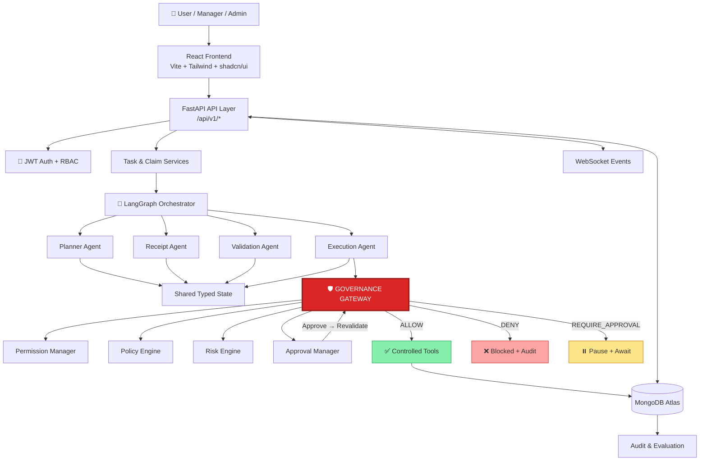
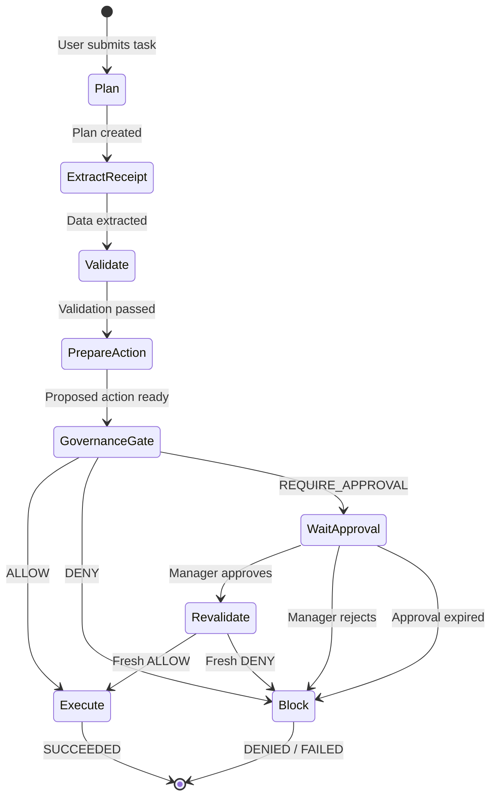
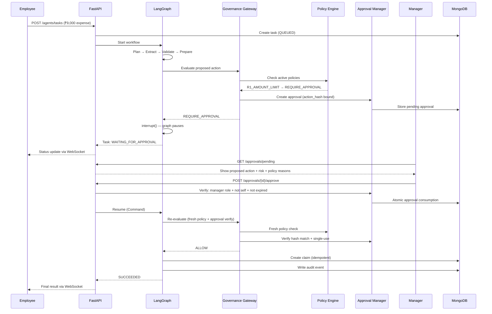
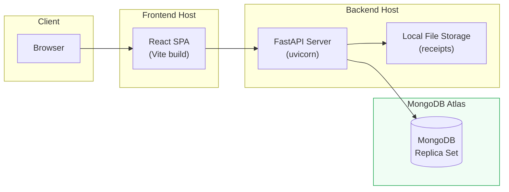

# Architecture — AgentShield AI

> **Autonomous Intelligence. Governed Execution. Trusted Outcomes.**

---

## 1  Design Principles

| Principle | How it is enforced |
|:----------|:-------------------|
| **Governance is code, not a prompt** | Policy engine is a deterministic Python module — no LLM in the decision path |
| **Fail closed** | Any error in policy, permission, approval, or risk → DENY. No uncertain operation executes |
| **Agents propose, gateway decides** | Agents produce proposed actions; only the Governance Gateway returns ALLOW / DENY / REQUIRE_APPROVAL |
| **Exact-action approval** | Approval is bound to SHA-256 of canonical action. Any change → old approval invalid |
| **Single-use, time-bound approval** | Once consumed, approval cannot be replayed. Expired approvals are rejected |
| **Least privilege** | Agents receive only allowlisted tools. No shell, no browser, no arbitrary code |
| **Untrusted data** | Receipt text, user input, LLM output, filenames — all treated as untrusted. Never promoted to instructions |
| **Audit everything** | Every governance decision, approval action, tool execution, and failure is logged |

---

## 2  High-Level System Architecture



---

## 3  Trust Boundary

```mermaid
flowchart LR
    subgraph UNTRUSTED["UNTRUSTED ZONE"]
        direction TB
        A1["User input / prompts"]
        A2["Receipt content / OCR"]
        A3["LLM output"]
        A4["Agent 'approved' flag"]
        A5["Client-supplied role"]
    end

    subgraph GATE["GOVERNANCE GATEWAY"]
        direction TB
        B1["1. Authenticate principal"]
        B2["2. Validate agent identity"]
        B3["3. Check RBAC permissions"]
        B4["4. Evaluate policies"]
        B5["5. Calculate risk"]
        B6["6. Verify approval if needed"]
        B7["7. Return ALLOW / DENY / REQUIRE_APPROVAL"]
    end

    subgraph TRUSTED["TRUSTED ZONE"]
        direction TB
        C1["Controlled tool execution"]
        C2["MongoDB write"]
        C3["Audit log"]
    end

    UNTRUSTED --> GATE --> TRUSTED

    style UNTRUSTED fill:#fef2f2,stroke:#dc2626,stroke-width:2px
    style GATE fill:#fffbeb,stroke:#d97706,stroke-width:3px
    style TRUSTED fill:#f0fdf4,stroke:#16a34a,stroke-width:2px
```



---

## 4  Component Layers

```
┌─────────────────────────────────────────────────────┐
│  FRONTEND — React + Vite + Tailwind + shadcn/ui     │
│  Pages: Login · Dashboard · Agent Chat · Claims     │
│         Approvals · Policies · Audit · Evaluation   │
├─────────────────────────────────────────────────────┤
│  API LAYER — FastAPI + Pydantic + WebSocket         │
│  /api/v1/auth · agents · claims · approvals ·       │
│  policies · audit-logs · evaluations · dashboard    │
├─────────────────────────────────────────────────────┤
│  IDENTITY — JWT Auth · RBAC Middleware              │
├─────────────────────────────────────────────────────┤
│  APPLICATION SERVICES — Task · Claim · Auth         │
├─────────────────────────────────────────────────────┤
│  ORCHESTRATION — LangGraph StateGraph               │
│  Planner · Receipt · Validation · Execution Agents  │
│  Checkpointer · Typed State · Conditional Edges     │
├─────────────────────────────────────────────────────┤
│  GOVERNANCE — Independent Authorization Boundary    │
│  Gateway · Policy Engine · Permission Manager       │
│  Risk Engine · Approval Manager · Audit Service     │
├─────────────────────────────────────────────────────┤
│  TOOL LAYER — Allowlisted Only                      │
│  Receipt Reader · Expense Validator                 │
│  Duplicate Checker · Claim Executor                 │
├─────────────────────────────────────────────────────┤
│  PERSISTENCE — PyMongo Repositories · Indexes       │
│  MongoDB Atlas · Local File Storage                 │
└─────────────────────────────────────────────────────┘
```

---

## 5  Technology Stack

| Layer | Technology |
|:------|:-----------|
| Frontend | React 18 · Vite 6 · JavaScript · Tailwind CSS 3 · shadcn/ui · Axios · Recharts · React Router 6 |
| Backend | Python 3.10 · FastAPI · Pydantic v2 · PyMongo · WebSockets |
| Auth | JWT (PyJWT) · bcrypt password hashing |
| Agents | LangGraph · LangChain Core · Gemini API (langchain-google-genai) |
| Database | MongoDB Atlas · PyMongo 4.16 |
| Testing | Pytest · FastAPI TestClient · httpx |
| Deployment | Docker · Docker Compose |

---

## 6  LangGraph Workflow



---

## 7  Approval Sequence Diagram



---

## 8  Deployment Diagram


