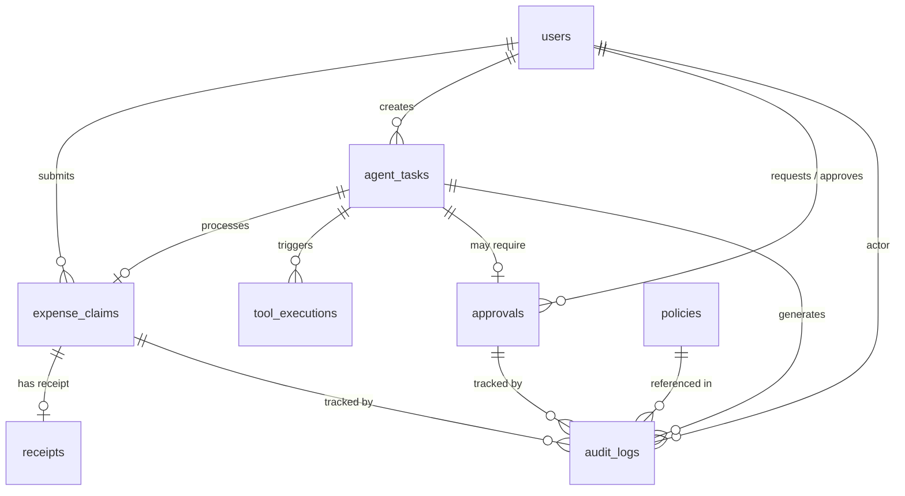

# Database Design — AgentShield AI

> MongoDB Atlas · PyMongo · No ORM

---

## Collections Overview

| # | Collection | Purpose | Key Indexes |
|:-:|:-----------|:--------|:------------|
| 1 | `users` | User accounts and credentials | unique email (case-insensitive) |
| 2 | `expense_claims` | Simulated expense claims | unique claim_id · user_id+status · created_at |
| 3 | `receipts` | Receipt metadata and extraction results | unique receipt_id · owner_id · file_hash |
| 4 | `policies` | Configurable policy rules | unique policy_id · name+version · active |
| 5 | `agent_tasks` | Workflow/task state | unique task_id · requester_id+status · created_at |
| 6 | `tool_executions` | Controlled tool attempts and results | unique execution_id · unique idempotency_key (sparse) |
| 7 | `approvals` | Human approval lifecycle | unique approval_id · task_id+status · status+expires_at |
| 8 | `audit_logs` | Security and business audit events | task_id · claim_id · actor_id · timestamp · correlation_id |
| 9 | `evaluations` | Benchmark and evaluation results | run_id · case_id |

---

## 1  `users`

| Field | Type | Required | Description |
|:------|:-----|:--------:|:------------|
| `_id` | ObjectId | auto | MongoDB default |
| `user_id` | string | ✅ | UUID, unique |
| `email` | string | ✅ | Unique, normalized lowercase |
| `password_hash` | string | ✅ | bcrypt hash, never plaintext |
| `full_name` | string | ✅ | Display name |
| `role` | string | ✅ | `EMPLOYEE` / `MANAGER` / `ADMIN` |
| `status` | string | ✅ | `active` / `inactive` |
| `department` | string | — | Optional organizational unit |
| `created_at` | datetime | ✅ | ISO 8601 |
| `updated_at` | datetime | ✅ | ISO 8601 |

**Indexes:**
- `{ email: 1 }` — unique, collation `{ locale: "en", strength: 2 }`
- `{ user_id: 1 }` — unique
- `{ role: 1, status: 1 }`

**Example document:**
```json
{
  "user_id": "u-a1b2c3d4",
  "email": "priya.sharma@example.com",
  "password_hash": "$2b$12$...",
  "full_name": "Priya Sharma",
  "role": "EMPLOYEE",
  "status": "active",
  "department": "Engineering",
  "created_at": "2026-11-03T10:00:00Z",
  "updated_at": "2026-11-03T10:00:00Z"
}
```

---

## 2  `expense_claims`

| Field | Type | Required | Description |
|:------|:-----|:--------:|:------------|
| `claim_id` | string | ✅ | UUID, unique |
| `user_id` | string | ✅ | FK → users.user_id |
| `amount` | float | ✅ | Positive number |
| `currency` | string | ✅ | Default `INR` |
| `category` | string | ✅ | travel / meals / lodging / transport / supplies |
| `description` | string | — | Free text |
| `merchant` | string | — | Extracted or entered |
| `expense_date` | string | — | Date of expense |
| `status` | string | ✅ | See state machine below |
| `receipt_id` | string | — | FK → receipts.receipt_id |
| `task_id` | string | — | FK → agent_tasks.task_id |
| `action_hash` | string | — | SHA-256 of canonical action |
| `idempotency_key` | string | — | Prevents duplicate submission |
| `created_at` | datetime | ✅ | |
| `updated_at` | datetime | ✅ | |

**Claim status state machine:**
```
DRAFT → PROCESSING → PENDING_APPROVAL → APPROVED → SUBMITTED
                   → DENIED
                   → FAILED
                   → CANCELLED
                   → REJECTED
```

**Indexes:**
- `{ claim_id: 1 }` — unique
- `{ user_id: 1, status: 1 }`
- `{ user_id: 1, created_at: -1 }`
- `{ idempotency_key: 1 }` — unique, sparse
- `{ task_id: 1 }`

**Example document:**
```json
{
  "claim_id": "c-x7y8z9",
  "user_id": "u-a1b2c3d4",
  "amount": 4500.0,
  "currency": "INR",
  "category": "travel",
  "description": "Business travel to Mumbai",
  "merchant": "Indian Railways",
  "expense_date": "2026-11-01",
  "status": "SUBMITTED",
  "receipt_id": "r-m1n2o3",
  "task_id": "t-p4q5r6",
  "action_hash": "a1b2c3d4e5f6g7h8",
  "idempotency_key": "idem-abc123",
  "created_at": "2026-11-03T10:15:00Z",
  "updated_at": "2026-11-03T10:16:00Z"
}
```

---

## 3  `receipts`

| Field | Type | Required | Description |
|:------|:-----|:--------:|:------------|
| `receipt_id` | string | ✅ | UUID, unique |
| `owner_id` | string | ✅ | FK → users.user_id |
| `original_filename` | string | ✅ | User's filename (for display only) |
| `storage_key` | string | ✅ | Server-generated safe path |
| `content_type` | string | ✅ | Validated MIME type |
| `file_size` | int | ✅ | Bytes |
| `file_hash` | string | ✅ | SHA-256 of file content |
| `extracted_data` | object | — | `{ merchant, date, amount, currency, category }` |
| `confidence` | float | — | 0.0–1.0 extraction confidence |
| `extraction_warnings` | array | — | Issues found during extraction |
| `created_at` | datetime | ✅ | |

**Indexes:**
- `{ receipt_id: 1 }` — unique
- `{ owner_id: 1 }`
- `{ file_hash: 1 }` — for duplicate detection

---

## 4  `policies`

| Field | Type | Required | Description |
|:------|:-----|:--------:|:------------|
| `policy_id` | string | ✅ | UUID, unique |
| `name` | string | ✅ | Human-readable policy name |
| `version` | int | ✅ | Incremented on update |
| `description` | string | — | |
| `rules` | array | ✅ | List of rule objects (see below) |
| `active` | bool | ✅ | Only active policies are evaluated |
| `created_by` | string | ✅ | FK → users.user_id |
| `updated_by` | string | — | |
| `created_at` | datetime | ✅ | |
| `updated_at` | datetime | ✅ | |

**Rule object shape:**
```json
{
  "rule_id": "R1_AMOUNT_LIMIT",
  "rule_type": "amount_threshold",
  "parameters": { "threshold": 5000 },
  "decision": "REQUIRE_APPROVAL",
  "priority": 10,
  "description": "Claims above ₹5,000 require manager approval"
}
```

**Indexes:**
- `{ policy_id: 1 }` — unique
- `{ name: 1, version: 1 }` — unique compound
- `{ active: 1 }`

---

## 5  `agent_tasks`

| Field | Type | Required | Description |
|:------|:-----|:--------:|:------------|
| `task_id` | string | ✅ | UUID, unique |
| `requester_id` | string | ✅ | FK → users.user_id |
| `input_text` | string | ✅ | Natural language request |
| `input_data` | object | — | Structured input (amount, category, etc.) |
| `status` | string | ✅ | See state machine |
| `plan` | object | — | Planner agent output |
| `receipt_data` | object | — | Receipt agent output |
| `validation_findings` | object | — | Validation agent output |
| `proposed_action` | object | — | Execution agent output |
| `governance_decision` | string | — | ALLOW / DENY / REQUIRE_APPROVAL |
| `governance_reasons` | array | — | List of reason codes |
| `risk_assessment` | object | — | Score, level, factors |
| `approval_id` | string | — | FK → approvals.approval_id |
| `execution_result` | object | — | Tool execution output |
| `error` | string | — | Error message if failed |
| `agent_trace` | array | — | `[{ agent, action, result, timestamp }]` |
| `claim_id` | string | — | FK → expense_claims.claim_id |
| `checkpoint_ref` | string | — | LangGraph checkpoint reference |
| `created_at` | datetime | ✅ | |
| `updated_at` | datetime | ✅ | |
| `completed_at` | datetime | — | |

**Task status state machine:**
```
QUEUED → RUNNING → WAITING_FOR_APPROVAL → RUNNING → SUCCEEDED
                 → FAILED
                 → DENIED
                 → CANCELLED
                 → EXPIRED
```

**Indexes:**
- `{ task_id: 1 }` — unique
- `{ requester_id: 1, status: 1 }`
- `{ requester_id: 1, created_at: -1 }`
- `{ status: 1, created_at: -1 }`

---

## 6  `tool_executions`

| Field | Type | Required | Description |
|:------|:-----|:--------:|:------------|
| `execution_id` | string | ✅ | UUID, unique |
| `task_id` | string | ✅ | FK → agent_tasks.task_id |
| `tool_name` | string | ✅ | e.g., `submit_claim` |
| `action_hash` | string | ✅ | SHA-256 of canonical action |
| `parameters` | object | ✅ | Tool input parameters |
| `status` | string | ✅ | REQUESTED / AUTHORIZED / SUCCEEDED / FAILED |
| `result` | object | — | Tool output |
| `idempotency_key` | string | — | Prevents duplicate execution |
| `governance_decision_id` | string | ✅ | Reference to the ALLOW decision |
| `approved_by` | string | — | Approver user_id if applicable |
| `error` | string | — | Error details if failed |
| `created_at` | datetime | ✅ | |
| `completed_at` | datetime | — | |

**Indexes:**
- `{ execution_id: 1 }` — unique
- `{ idempotency_key: 1 }` — unique, sparse
- `{ task_id: 1 }`

---

## 7  `approvals`

| Field | Type | Required | Description |
|:------|:-----|:--------:|:------------|
| `approval_id` | string | ✅ | UUID, unique |
| `task_id` | string | ✅ | FK → agent_tasks.task_id |
| `claim_id` | string | — | FK → expense_claims.claim_id |
| `requester_id` | string | ✅ | Who requested the action |
| `approver_id` | string | — | Who approved/rejected |
| `approver_role` | string | — | Role at time of approval |
| `action_hash` | string | ✅ | SHA-256 of proposed action |
| `proposed_action` | object | ✅ | Full proposed action for review |
| `policy_snapshot` | object | — | Policy state at request time |
| `risk_assessment` | object | — | Risk score and factors |
| `status` | string | ✅ | PENDING / APPROVED / REJECTED / EXPIRED / INVALIDATED |
| `reason` | string | — | Approver's reason |
| `expires_at` | datetime | ✅ | Auto-expire if not acted on |
| `consumed_at` | datetime | — | When the approval was used |
| `created_at` | datetime | ✅ | |
| `updated_at` | datetime | ✅ | |

**Approval state machine:**
```
PENDING → APPROVED → (consumed)
        → REJECTED
        → EXPIRED
        → INVALIDATED (action changed)
```

**Indexes:**
- `{ approval_id: 1 }` — unique
- `{ task_id: 1, status: 1 }`
- `{ status: 1, expires_at: 1 }` — for expiry queries
- `{ approver_id: 1, status: 1 }`

---

## 8  `audit_logs`

| Field | Type | Required | Description |
|:------|:-----|:--------:|:------------|
| `event_id` | string | ✅ | UUID, unique |
| `actor_id` | string | ✅ | Who performed the action |
| `actor_role` | string | ✅ | Role at time of action |
| `action` | string | ✅ | e.g., `governance_evaluate`, `approval_create` |
| `resource_type` | string | ✅ | e.g., `claim`, `task`, `approval` |
| `resource_id` | string | — | ID of the resource |
| `decision` | string | — | ALLOW / DENY / REQUIRE_APPROVAL |
| `reason_codes` | array | — | List of policy rule IDs |
| `details` | object | — | Additional context (no secrets) |
| `correlation_id` | string | — | Links related events |
| `task_id` | string | — | FK → agent_tasks.task_id |
| `claim_id` | string | — | FK → expense_claims.claim_id |
| `ip_address` | string | — | Client IP (optional) |
| `timestamp` | datetime | ✅ | Event time |

**Indexes:**
- `{ event_id: 1 }` — unique
- `{ task_id: 1, timestamp: -1 }`
- `{ claim_id: 1, timestamp: -1 }`
- `{ actor_id: 1, timestamp: -1 }`
- `{ action: 1, timestamp: -1 }`
- `{ correlation_id: 1 }`

**Note:** Application-level append-only. Audit modification is restricted through application permissions. This is NOT cryptographic immutability.

---

## 9  `evaluations`

| Field | Type | Required | Description |
|:------|:-----|:--------:|:------------|
| `run_id` | string | ✅ | Evaluation run identifier |
| `case_id` | string | ✅ | Test case identifier |
| `group` | string | ✅ | normal / violating / adversarial |
| `expected` | string | ✅ | Expected decision |
| `actual` | string | ✅ | Actual decision |
| `outcome` | string | ✅ | pass / fail |
| `system` | string | ✅ | baseline / governed |
| `metrics` | object | — | Latency, details |
| `timestamp` | datetime | ✅ | |

**Indexes:**
- `{ run_id: 1, case_id: 1 }`
- `{ run_id: 1, system: 1 }`

---

## 10  Collection Relationships



---

## Consistency and Safety Rules

1. **Atomic status transitions** — use `update_one` with `{ status: current_status }` filter to prevent race conditions
2. **Idempotency keys** — unique sparse index prevents duplicate tool execution
3. **Receipt hash** — SHA-256 of file content for duplicate detection
4. **Action hash** — SHA-256 of canonical action for approval binding
5. **Approval consumption** — atomic `find_one_and_update` with `{ status: "PENDING" }` condition
6. **No large blobs** — store file metadata in MongoDB, actual files in storage
7. **Sensitive data** — never log receipt content, passwords, or API keys in audit
