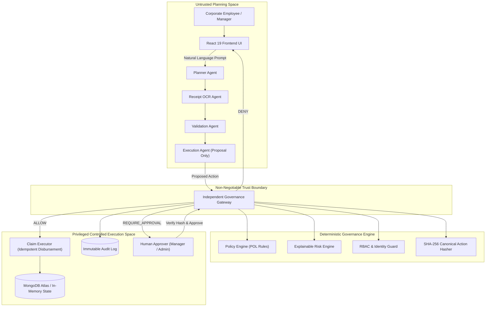
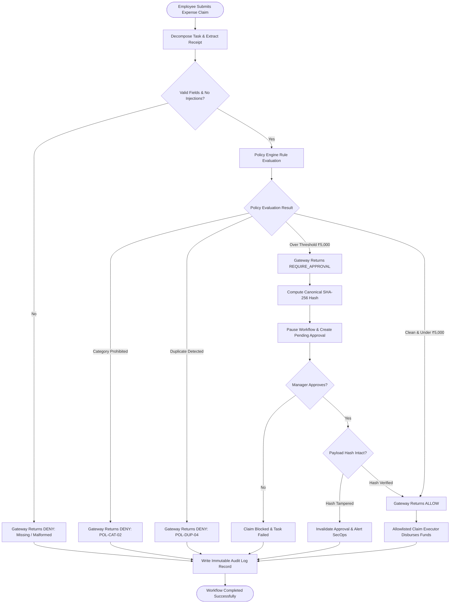
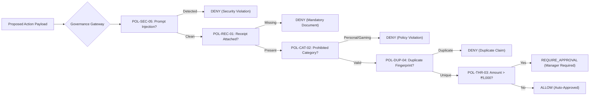
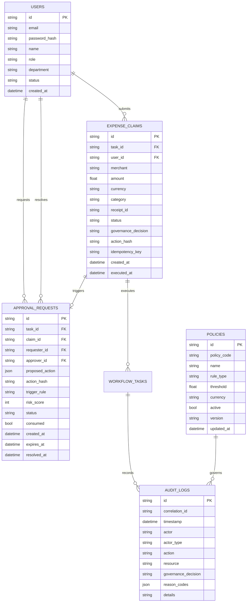
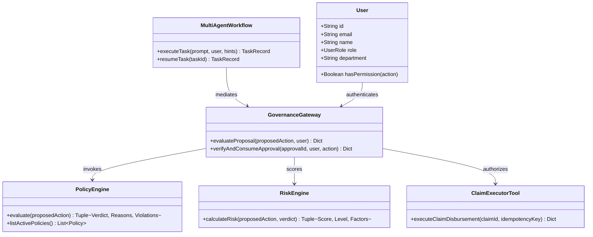
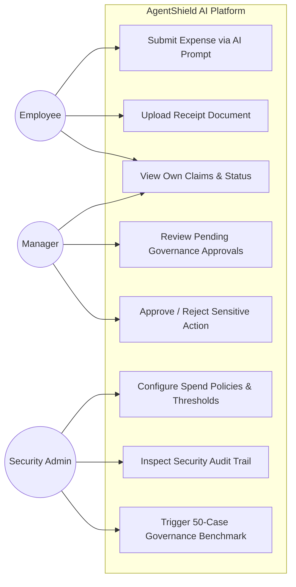
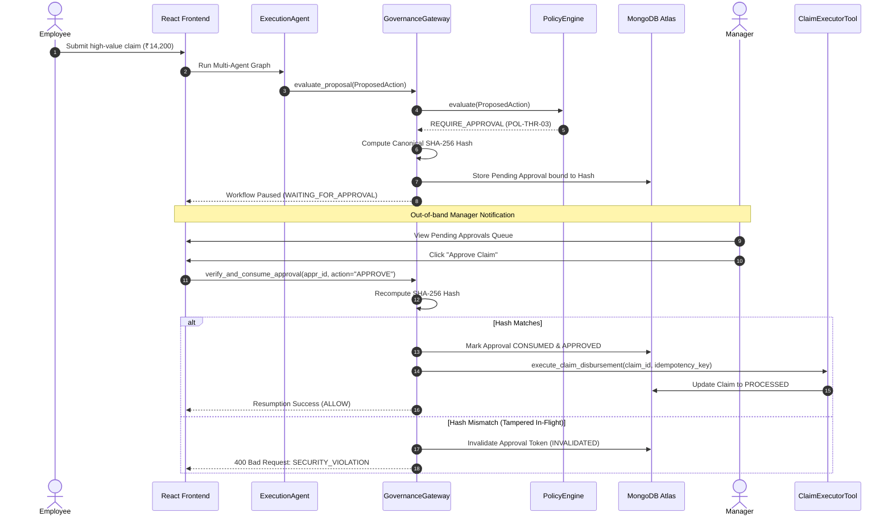
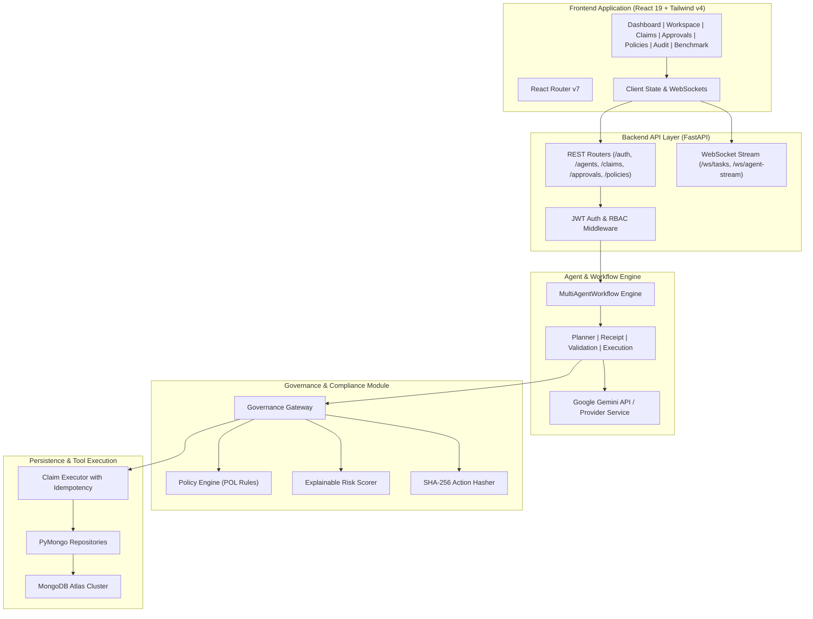
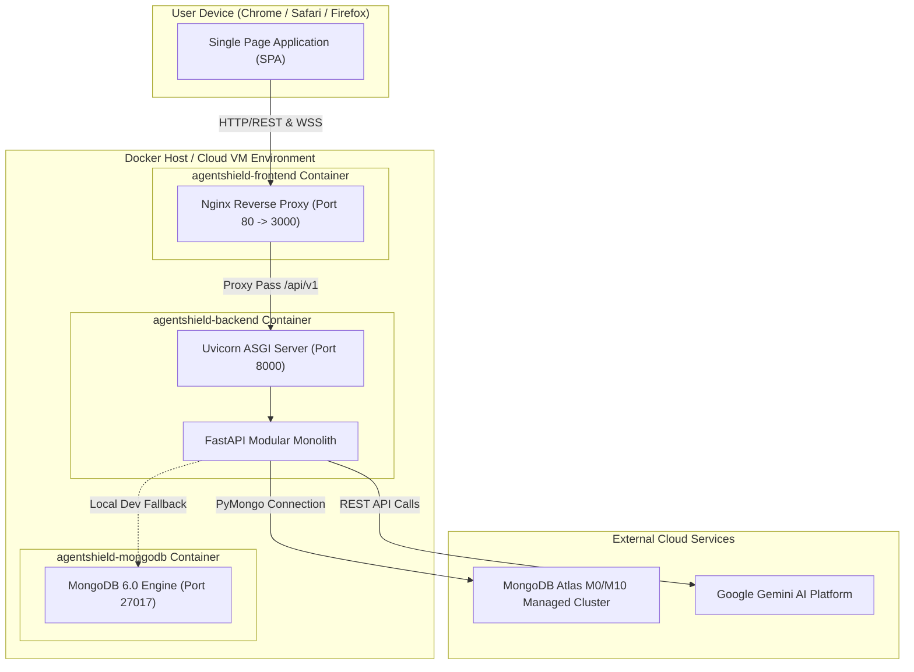
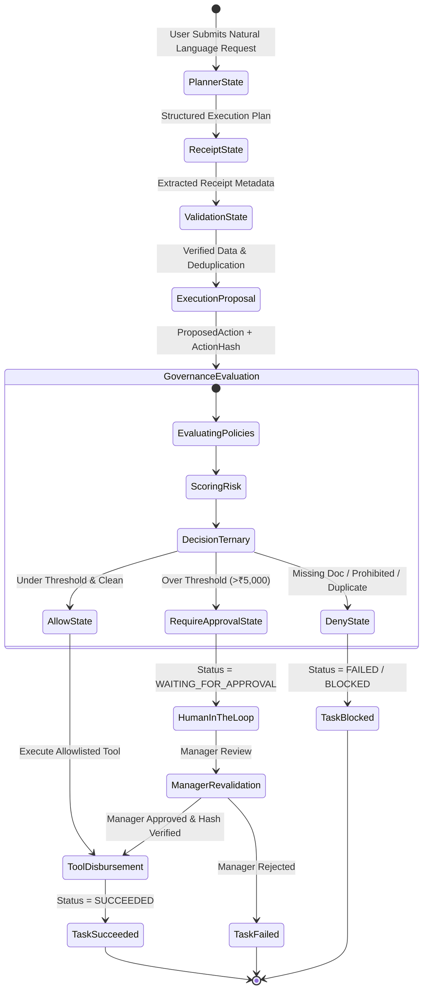

# AgentShield AI — Architecture & System Design

## 1. System Overview & Trust Boundary

AgentShield AI is an enterprise-grade, policy-governed framework for secure, autonomous AI agent execution. While modern LLM agents can autonomously decompose goals and propose workflows, they must **never** hold the authority to approve or execute privileged actions. 

AgentShield enforces a strict, independent **Trust Boundary**: the LLM and its specialist agents operate in an untrusted planning space, while all sensitive operations (e.g., expense disbursements, database writes, external mutations) are mediated by an independent, deterministic **Governance Gateway**.

---

## 2. Mermaid System Design Diagrams (All 10 Core Views)

### Diagram 1: High-Level System Architecture

### Diagram 2: End-to-End Workflow Flowchart

### Diagram 3: Governance Decision Flow

### Diagram 4: MongoDB Collection Relationship Diagram (ERD)

### Diagram 5: UML Domain Model

### Diagram 6: System Use-Case Diagram

### Diagram 7: Sequence Diagram for Approval & Resume

### Diagram 8: Component Diagram

### Diagram 9: Deployment Diagram

### Diagram 10: Multi-Agent Workflow State Machine

