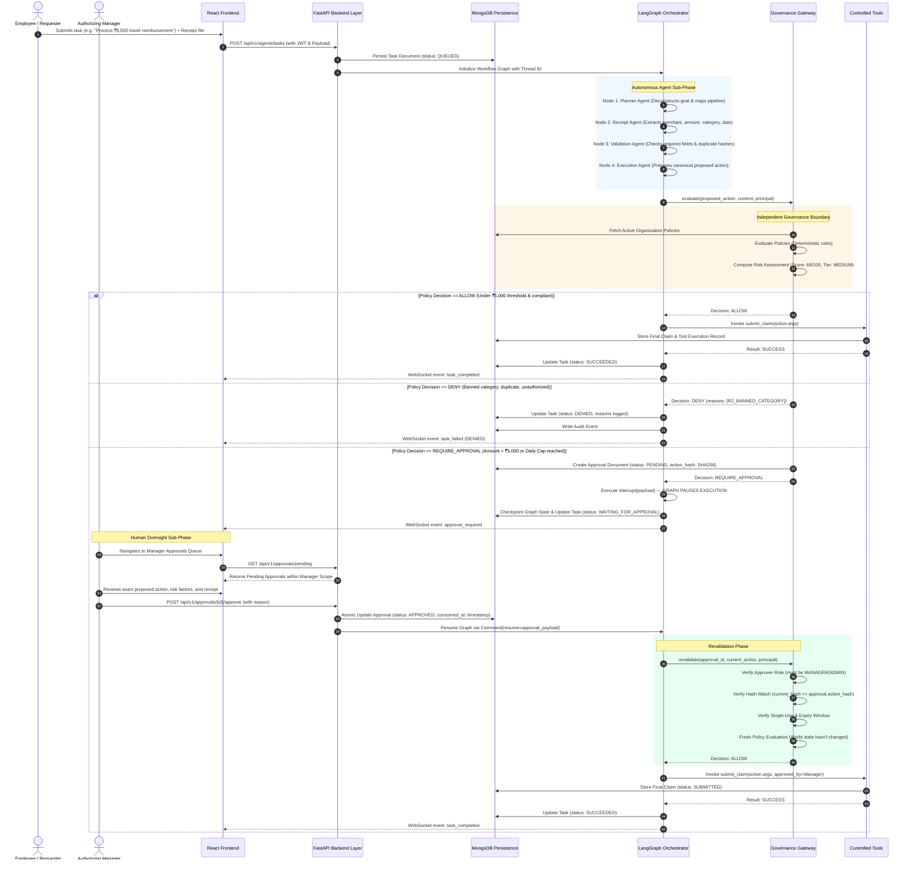

# Workflow Specification & Lifecycle — AgentShield AI

## 1. End-to-End Workflow Diagram



---

## 2. State Machine Formal Definitions

### 2.1 Task State Machine (`agent_tasks`)
```
 ┌──────────┐
 │  QUEUED  │
 └────┬─────┘
      │ Orchestration Worker Pops Task
      ▼
 ┌──────────┐
 │ RUNNING  │◄─────────────────────────────┐
 └────┬─────┘                              │
      │                                    │ Manager Approved
      ├──────────────┬─────────────────┐   │ & Revalidation Passes
      │              │                 │   │
      │ ALLOW        │ DENY            │ REQUIRE_APPROVAL
      ▼              ▼                 ▼   │
 ┌──────────┐   ┌──────────┐   ┌──────────────────────┐
 │SUCCEEDED │   │  DENIED  │   │ WAITING_FOR_APPROVAL │
 └──────────┘   └──────────┘   └──────────┬───────────┘
                                          │
                                          ├───────────────┐
                                          │ Rejected      │ Expired /
                                          ▼               ▼ Invalidated
                                     ┌──────────┐   ┌───────────┐
                                     │  DENIED  │   │  EXPIRED  │
                                     └──────────┘   └───────────┘
```

**Permitted Transitions:**
- `QUEUED` → `RUNNING`, `CANCELLED`
- `RUNNING` → `SUCCEEDED`, `DENIED`, `WAITING_FOR_APPROVAL`, `FAILED`
- `WAITING_FOR_APPROVAL` → `RUNNING` (upon approval resume), `DENIED` (upon rejection), `EXPIRED` (timeout)
- Terminal States: `SUCCEEDED`, `DENIED`, `FAILED`, `CANCELLED`, `EXPIRED`

---

### 2.2 Approval Lifecycle State Machine (`approvals`)

```
 ┌───────────┐
 │  PENDING  │
 └─────┬─────┘
       │
       ├───────────────────┬───────────────────┬──────────────────┐
       │ Manager Approves  │ Manager Rejects   │ TTL Exceeded     │ Action Tampered
       ▼                   ▼                   ▼                  ▼
 ┌───────────┐       ┌───────────┐       ┌───────────┐      ┌─────────────┐
 │ APPROVED  │       │ REJECTED  │       │  EXPIRED  │      │ INVALIDATED │
 └─────┬─────┘       └───────────┘       └───────────┘      └─────────────┘
       │
       │ Atomic Execution Consumption
       ▼
 ┌───────────┐
 │ CONSUMED  │ (Single-use complete; replay impossible)
 └───────────┘
```

---

## 3. Exact-Action Cryptographic Binding

To prevent **Time-of-Check to Time-of-Use (TOCTOU)** attacks and parameter mutation after sign-off, approvals are bound to a cryptographic digest:

### Canonical Digest Formula:
$$\text{ActionHash} = \text{SHA256}\Big(\text{CanonicalJSON}\big(\text{tool}, \text{sorted}(\text{essential\_args})\big)\Big)_{0..16}$$

- **Included Arguments:** `tool`, `employee`, `amount`, `currency`, `category`, `receipt_id`, `merchant`.
- **Excluded Arguments:** Free-form user comments, decorative UI notes, display timestamps.
- **Verification Rule:** If any financial or operational field is altered between the manager's review and the revalidation check, $\text{ActionHash}_{\text{current}} \neq \text{ActionHash}_{\text{approved}}$, immediately invalidating the workflow and transitioning the task to `DENIED`.
